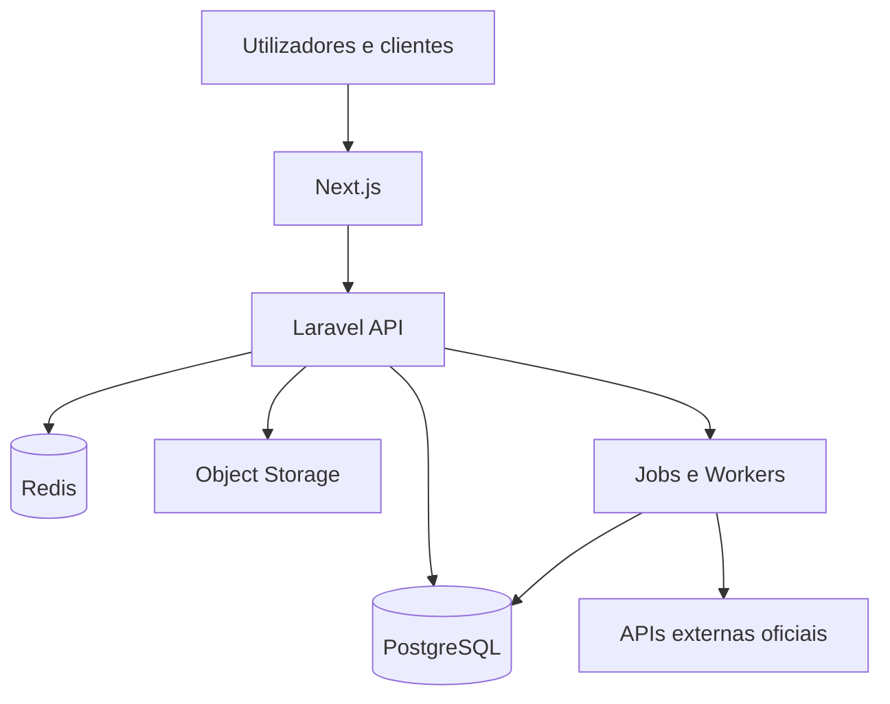

# Arquitectura técnica e decisões (ADR)
## ADR-001 — Nova base, monólito modular
**Estado:** proposta aceite pelo briefing. Criar repositório novo. Não copiar HolyCRM sem revisão e autorização explícita.

## ADR-002 — Stack
- API: PHP 8.3+ e Laravel em versão estável suportada no início da implementação.
- UI: Next.js App Router, TypeScript strict, React, Tailwind CSS, componentes acessíveis.
- Dados: PostgreSQL; Redis para cache, filas e rate limits.
- Armazenamento: object storage compatível com S3 em produção; disco local só em desenvolvimento.
- Observabilidade: logs estruturados, Sentry ou equivalente, métricas e alertas básicos.
- Testes: PHPUnit/Pest (escolher um), testes UI e E2E com Playwright.

## ADR-003 — Estrutura do repositório
```text
vitaleevo-ecosystem/
  apps/
    api/                  # Laravel
    web/                  # Next.js tenant + páginas públicas
    owner/                # Opcional: só separar quando justificado
  packages/
    ui/                   # Design system compartilhado quando houver 2 consumidores
    contracts/            # Schemas/cliente gerado, se necessário
  infra/
    docker/
    deploy/
  docs/
```
**Preferência inicial:** um único frontend Next.js com rotas e layouts separados para público, empresa e owner. Evitar `apps/owner` e `packages/ui` prematuros.

## Módulos Laravel
`Identity`, `Tenancy`, `Platform`, `CRM`, `ServiceCatalog`, `ServiceRequests`, `Professionals`, `Notifications`, `Billing` (mínimo de plano beta), `Integrations` (contratos), `Audit`.

Cada módulo mantém `Actions`, `Models`, `Policies`, `Queries`, `Events`, `Listeners` e `Http` **somente quando necessários**. Proibido criar camadas vazias para cumprir um padrão.

## Regras de dependência
- Core não importa módulos de negócio.
- Comunicação síncrona via contratos explícitos e actions.
- Eventos internos para efeitos secundários: notificação, auditoria, analytics.
- Jobs idempotentes com retries controlados e tenant explícito.
- Nunca consultar base de dados de outro módulo por atalhos que violem invariantes.

## ADR-004 — Rust e NestJS
Não entram no MVP. Introduzir **Rust/Axum** apenas com benchmark de CPU, latência ou segurança de memória que justifique extracção; **NestJS** apenas para integração/event streaming/serviço TypeScript com benefício operacional demonstrado. Toda extracção exige contrato API/eventos, observabilidade, rollback e análise de custo.

## ADR-005 — Escalabilidade
Aplicações stateless, múltiplas instâncias API, workers horizontais, filas separadas por criticidade, índices e paginação por cursor quando necessário. Começar com deploy simples e monitorizar p95, erros, CPU, filas, custos e queries lentas.

## Diagrama

